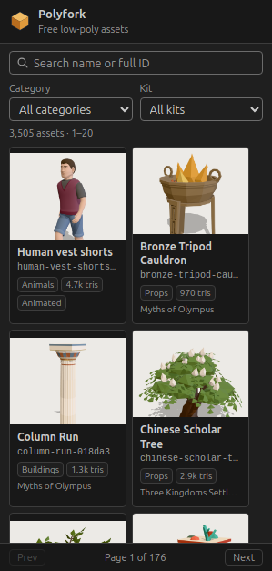
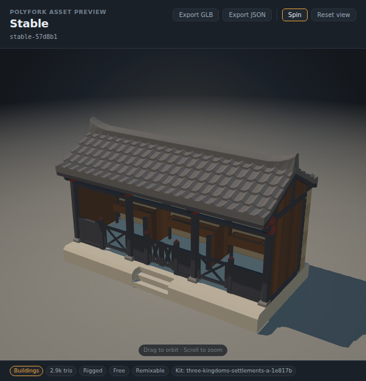
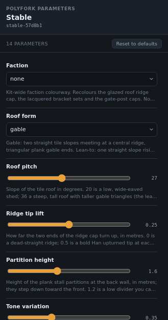
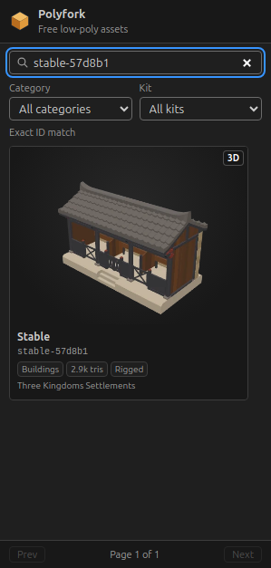

# exo-polyfork

[](https://github.com/mode777/exo-polyfork/actions/workflows/deploy.yml)

A [Polyfork](https://polyfork.dev) asset browser for the [Exo editor](https://mode777.github.io/exo-editor/).

The plugin adds a **package icon** to Exo's activity bar and a **left side-bar
panel** that browses the free Polyfork low-poly catalogue. It filters by name,
full asset id, category and kit, shows 20 assets per page, and renders missing
thumbnails with three.js from the asset's parametric `.mjs` module. Selecting an
asset opens a reusable **Asset Preview** content-view tab with an interactive 3D
model: drag to orbit, scroll to zoom, spin or reset the view. The preview
declares a **Parameters** companion panel in the right side bar, built from
Polyfork's public `{id}-params.json` schema; every change rebuilds the preview
model with `createAsset(params)`. The preview header can save the current model
as **GLB** or save its parameters plus the generator module URL as **JSON**.







<details>
<summary>Thumbnail fallback rendered from the asset module</summary>



</details>

## Install

Add the deployed manifest to the workspace root `exo.json`:

```json
{
  "schemaVersion": 1,
  "plugins": [
    {
      "manifest": "https://mode777.github.io/exo-polyfork/exo-manifest.json",
      "enabled": true
    }
  ]
}
```

Reload Exo, open the folder, and approve the consent dialog. The plugin requests
`events:subscribe` (theme changes and its own frame-to-frame selection channel)
and `workspace:read`/`workspace:write` so the preview can save generated exports
through Exo's own Save As dialog. It never reads workspace files, never picks a
path itself and cannot overwrite an existing file. Click the package icon in the
activity bar to open the **Assets** panel.

Requires Exo shell `0.6.0` or newer (panels, content views and companion
panels). It is built and tested against shell `0.6.0` with `@exo/plugin-sdk`
`1.7.0`.

## Using the panel

- **Search** matches names through Polyfork's word-scored search. A **full asset
  id** (for example `stable-57d8b1` or `general-base`) is resolved through the
  detail endpoint, because Polyfork's text search does not index ids. Partial
  ids are not looked up; use a name for partials.
- **Category** maps to Polyfork's `class` filter: props, buildings, vehicles,
  characters, animals, Nano shelf items, attachments, terrain and hands.
- **Kit** lists every published Polyfork kit from `/api/kits`. Kit names are
  shown on each card.
- **Prev / Next** moves through 20 assets at a time. The status line shows the
  total and the visible range.
- **Select** a card (click, or keyboard Enter/Space) to open the **Asset
  Preview** tab. The shell reveals its **Parameters** companion panel in the
  right side bar and keeps it there while the preview is open. The preview
  imports the same `{id}.mjs` module, frames it with an orbit camera and keeps
  one tab alive, so selecting another asset updates the open preview instead of
  opening a tab per asset.
- **Export GLB** or **Export JSON** in the preview header saves the current
  configuration through Exo's Save As dialog. See [Exporting](#exporting).
- The catalogue is requested with `free=1`. The plugin never uses an API key and
  never requests the Pro-only HD editions.

## Parameters

When an asset has adjustable knobs, the preview fetches
`https://polyfork.dev/cdn/{id}-params.json` and sends the validated schema to
the right side-bar panel. The manifest declares the panel as the content view's
`companionPanel`; Exo reveals it when the preview opens or is focused, keeps it
open while any preview tab remains open, and hides it when the last one closes.
There is no plugin-side visibility polling or heartbeat.

The panel renders Polyfork's own labels and descriptions:

- **choice** as a select, **range** as a slider with its value, **color** as a
  colour input with the hex value, and **toggle** as a checkbox.
- Editing any control rebuilds the preview from the same cached `.mjs` module
  with `createAsset(params)`, so geometry and colour changes appear immediately.
- Named presets behind `colorway`/`faction` choices update the colour knobs they
  cover, matching `createAsset()`'s own preset handling.
- **Reset to defaults** restores the schema's published defaults.
- Assets without a schema show "This asset has no adjustable parameters"; the
  preview still renders the published model.

The preview view owns the schema and current values, and the panel edits them
over the plugin-local event channel. A panel that mounts after the preview
finished loading republishes the current state on request. Parameter edits stay
in memory; they reach the workspace only when you export them.

## Exporting

The Asset Preview header has two export actions for the current configuration:

- **Export GLB** reloads the parametric module with the current parameter
  values, converts that object with three.js `GLTFExporter` and saves the binary
  glTF through Exo's Save As dialog. The live scene's sky, ground disc and
  sun are not part of the export.
- **Export JSON** writes a small replayable recipe:

  ```json
  {
    "schemaVersion": 1,
    "assetId": "stable-57d8b1",
    "title": "Stable",
    "generator": "https://polyfork.dev/cdn/stable-57d8b1.mjs",
    "params": {
      "faction": "wei"
    }
  }
  ```

  `generator` is the exact module URL the preview imports, and `params` is the
  object passed to `createAsset(params)`.

Exports are create-only and go through the shell-owned Save As dialog; the
plugin never writes a workspace file directly and cannot overwrite an existing
file. This is why the manifest requests `workspace:write` (and the
`workspace:read` the shell requires alongside it). The plugin still never reads
workspace files. Exo caps a generated file at 8 MiB, and the GLB button reports
a clear error if a model exceeds it. No Polyfork GLB endpoint is requested: the
export is generated locally from the already-loaded module.

## Thumbnails and caching

Polyfork list rows usually carry a hero image. The plugin uses it when present.
When a row has no thumbnail, or the image fails to load, the plugin:

1. Dynamically imports `https://polyfork.dev/cdn/{id}.mjs`.
2. Calls `createAsset()` and frames the returned `THREE.Group`.
3. Renders one frame into a **hidden WebGL canvas** (512×384, off-screen) with
   `preserveDrawingBuffer: true`.
4. Shows the resulting WebP blob and caches it for the asset id.

The **asset preview** uses the same module loader and disposal helper as the
thumbnail path, but renders an interactive WebGL scene with `OrbitControls`
instead of a single off-screen frame. A procedural daytime sky is baked into a
PMREM environment map for soft image-based lighting, a large shadow-catching
ground disc fades into the stage backdrop, and a sun directional light casts
real-time shadows. Parametric edits call the same `createAsset(params)` factory
and swap the rebuilt `THREE.Group` into the live scene. If WebGL or the module
fails, the view falls back to Polyfork's hero image when the row has one.

No Polyfork GLB is downloaded, ever. The `-preview.glb` and `{id}.glb` endpoints
are not used; the parametric module is the only asset source. Exported `.glb`
files are generated in the browser by three.js and saved through Exo. The
end-to-end suite fails if any GLB request is observed.

Rendered thumbnails are cached in IndexedDB for 30 days (up to 300 entries) when
the page has a storage-capable origin. The deployed plugin is served from
`mode777.github.io`, the same origin as the Exo shell, so Exo mounts it with
`allow-scripts` and an opaque origin. In that mode IndexedDB is unavailable; the
plugin automatically falls back to an in-memory cache for the panel's lifetime.
Official thumbnail images still use the browser's normal HTTP cache. The code
prefers IndexedDB on any cross-origin host, so moving the plugin to a different
Pages owner or a custom domain enables persistent caching without changes.

## Development

```bash
npm install
npm run dev --workspace plugin   # http://localhost:5176/
```

The dev server is CORS-enabled. In a test workspace's `exo.json`, point at the
local manifest:

```json
{
  "schemaVersion": 1,
  "plugins": [
    { "manifest": "http://localhost:5176/exo-manifest.json", "enabled": true }
  ]
}
```

Open the workspace in the deployed shell and approve the localhost origin. A
panel only runs inside Exo; opening `panel.html` directly shows a boot error
because there is no shell handshake.

Useful checks:

```bash
npm test --workspace plugin       # unit tests
npm run build --workspace plugin  # typecheck + production build
npm test --workspace e2e          # real shell + live Polyfork API
```

The Playwright suite drives the deployed Exo shell with an in-memory File System
Access shim. It serves the local `plugin/dist` from a fake cross-origin host,
approves consent, clicks the activity-bar item, and verifies pagination, all
three filters, the exact-id lookup, the module-rendered thumbnail, the
content-view preview and its right side-bar parameters panel, a parameter edit
that rebuilds the model, reusing that preview for a second selection, the GLB
and JSON exports, and the absence of GLB requests. Set `EXO_SCREENSHOT=1` to
refresh `docs/screenshot.png`, `docs/fallback.png`, `docs/preview.png` and
`docs/parameters.png` while it runs.
For the deployed variant:

```bash
npm run test:deployed --workspace e2e
```

That variant points Exo at the published Pages manifest and also checks the
same-origin sandbox fallback (`data-cache="memory"`).

## Deployment

`.github/workflows/deploy.yml` builds the plugin, runs the end-to-end suite,
uploads `plugin/dist` as a Pages artifact, deploys it, then runs the suite again
against the published manifest. The Vite `base` is `/exo-polyfork/`; set
`EXO_PLUGIN_BASE_PATH` if the repository is forked under another name.

GitHub Pages must use **Settings → Pages → Source: GitHub Actions**. Pages
serves `.json` as `application/json` and sends `Access-Control-Allow-Origin: *`,
so the cross-origin manifest fetch needs no extra configuration.

## Layout

```text
sdk/                     vendored @exo/plugin-sdk 1.7.0 (unmodified)
plugin/
  plugin.html            controller page: registers the two panels and content view
  panel.html             Assets panel UI + three.js import map
  preview.html           Asset Preview content view + three.js import map
  parameters.html        Parameters right side-bar panel
  public/
    exo-manifest.json    identity, panel/content-view contributions, permissions
    icon.svg             plugin icon (the activity-bar icon is the package codicon)
  src/
    controller.ts        SDK register-mode handshake
    panel.ts             filters, pagination, cards, selection, theme, lifecycle
    preview.ts           content-view scene, orbit camera, parameter-driven rendering
    exports.ts           JSON config payload and export filenames
    preview-environment.ts daylight IBL, ground disc and shadow-casting sun
    parameters.ts        right side-bar controls and plugin-local edits
    preview-contract.ts  view id, instance key, local topics and payload validation
    parameters-contract.ts parameter schema and edit wire format
    api.ts               Polyfork REST client, schema parsing and pure helpers
    thumbnails.ts        hidden-canvas renderer + IndexedDB/memory cache
    asset-module.ts      shared module import and Object3D disposal
    panel.css
    preview.css
    parameters.css
e2e/                     Playwright suite against the deployed shell
```

## Polyfork terms

This plugin links to the free low-poly models on `polyfork.dev/cdn`; it does not
mirror, re-host or redistribute the asset files, and it does not ship the
catalogue. Polyfork's licence applies to the assets. Any product that serves
these assets to its own users at scale, or hosts its own copies of the `.mjs`
modules, needs its own arrangement with Polyfork; see
[polyfork.dev/licensing](https://polyfork.dev/licensing). Browsing and linking
are what this plugin does.

## References

- Exo plugin skill:
  <https://github.com/mode777/exo-editor/blob/main/.agents/skills/create-exo-plugin/SKILL.md>
- Exo contracts: <https://github.com/mode777/exo-editor/tree/main/docs/contracts>
- Polyfork catalogue as instructions: <https://polyfork.dev/prompt.txt>
- Polyfork API reference: <https://polyfork.dev/llms.txt>

## Licence

MIT for the plugin code. Polyfork assets retain their own licence.
